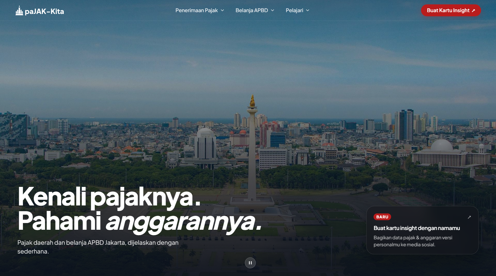
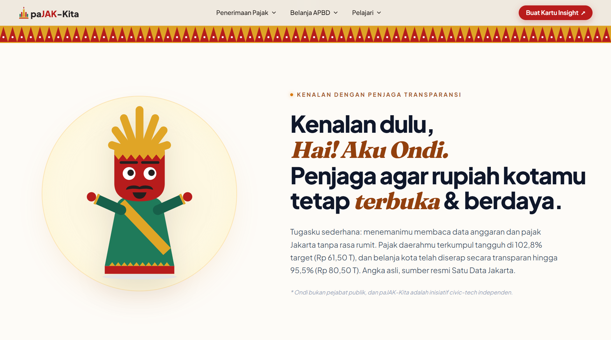

# paJAK-Kita 🏛️

Platform *civic-tech* independen untuk transparansi aliran pajak daerah dan alokasi belanja APBD Provinsi DKI Jakarta. Dirancang dengan pendekatan **Editorial Modern Betawi** agar data fiskal publik yang kompleks dapat dipahami oleh setiap warga secara terbuka, jujur, dan berdaya.

<p align="center">
  
</p>

---

## 🛠️ Tech Stack

- **Frontend Core:** Vanilla HTML5 Semantic, Modern CSS3 (CSS Variables, Flexbox, CSS Grid), JavaScript (ES6+ Vanilla Modules — *Zero runtime framework overhead*).
- **Tooling & Build:** Python SimpleHTTP Server / Native Browser ESM.
- **Tipografi & Desain:** Plus Jakarta Sans, Playfair Display, Palet Warna *Warm Alabaster* (`#F8F1E7`), *Betawi Gold* (`#E0A526`), *Carmine Red* (`#BA1A1A`), dan *Deep Charcoal* (`#0D1117`).
- **Animasi & Interaktivitas:** Motion / CSS Transitions, HTML5 Canvas (generator kartu ekspor PNG privat), dan SVG Dinamis Interaktif (*Eye-tracking pupil* Maskot Ondi).
- **Data & Integrasi:** API Gateway Satu Data Jakarta (`ws.jakarta.go.id`), Dashboard BPKD DKI Jakarta, dan SMART Planning & Budgeting Pemprov DKI Jakarta dengan *Local Fallback JSON Engine*.

---

## 🚀 Panduan Menjalankan Project (Local Development)

### 1. Clone repositori:
```bash
git clone https://github.com/raihanputra7/pajakita.git
cd PaJAK-Kita
```

### 2. Instal dependensi:
```bash
npm install
```

### 3. Jalankan server lokal:
```bash
npm run dev
# atau: python -m http.server 3000
```
Buka browser di alamat: `http://localhost:3000`

---

## 🏛️ Arsitektur Halaman & Fitur Unggulan

### 1. Beranda — Executive Summary (`index.html`)

<p align="center">
  
</p>

- **Full-Bleed Hero Slideshow:** Slideshow pemandangan Jakarta (*Ken Burns Effect*, *Crossfade*, kontrol *Play/Pause*, indikator slide, dan tipografi pembuka).
- **Maskot Ondi Interaktif:** Maskot ondel-ondel Betawi ramah warga dengan pupil mata yang bergerak mengikuti kursor mouse (*real-time eye-tracking*).
- **Ringkasan Eksekutif (2 Pilar Utama):**
  - *Pilar 01 — Penerimaan Pajak:* Target anggaran, realisasi terkumpul, persentase capaian, komparasi pajak vs retribusi, dan kepatuhan wajib pajak.
  - *Pilar 02 — Belanja APBD:* Pagu anggaran belanja, realisasi serapan, 4 kelompok belanja, dan highlight 3 sektor utama (Pendidikan, Kesehatan, Infrastruktur).
- **Pembuat Kartu Insight Warga (Rasio 3:4):** Generator kartu fakta pajak daerah berbasis *HTML5 Canvas* yang diproses **100% privat di peramban pengguna** tanpa ada data yang diunggah ke server.
- **Kamus Ringkas Terkurasi:** 7 kartu istilah kunci perpajakan + 1 kartu ajakan CTA khusus menuju glosarium lengkap.
- **Minimalist Ledger List (Tentang Data):** Tata letak asimetris 2 kolom gaya studio editorial dengan rincian sumber resmi, horizon periode 2022–2026, metodologi kalkulasi terbuka, dan kejujuran anomali data.
- **Editorial Onform Footer:** Footer gelap elegan dengan navigasi terstruktur dan *Giant Typography* `paJAK-Kita`.

### 2. Pilar 1: Penerimaan Pajak Daerah (`penerimaan.html`)
- **Dashboard Metrik Penerimaan:** KPI target anggaran, realisasi terkumpul, dan sisa target tahun berjalan.
- **Rincian 12 Jenis Pajak Daerah:** Menampilkan breakdown PKB, BBNKB, PBB-P2, BPHTB, PBJT (Makanan & Minuman, Tenaga Listrik, Perhotelan, Parkir, Kesenian & Hiburan), Pajak Reklame, PAT, dan Pajak Bahan Bakar.
- **Tren Musiman Bulanan (Dataset 09):** Visualisasi siklus puncak penerimaan kas daerah Jakarta (Mei–Juni untuk diskon PKB/BBNKB dan Agustus–September untuk jatuh tempo massal PBB-P2).
- **Sebaran Kepatuhan Wajib Pajak (Dataset 11):** Analisis pertumbuhan wajib pajak terdaftar dan rasio kepatuhan.

### 3. Pilar 2: Belanja APBD DKI Jakarta (`belanja.html`)
- **Dashboard Alokasi Belanja:** Pagu belanja kota, realisasi terserap, dan persentase penyerapan riil.
- **4 Kelompok Belanja Daerah:** Belanja Operasi, Belanja Modal, Belanja Tidak Terduga (BTT), dan Belanja Transfer.
- **Simulasi Interaktif Waffle Grid 10x10 ("Jika Belanja Rp100"):** Memetakan setiap seratus rupiah dana belanja APBD ke sektor riil layanan masyarakat.
- **Alokasi Dinas & Instansi Teknis (SKPD):** Tabel alokasi anggaran dinas-dinas pelayanan dasar warga (Dinas Pendidikan, Dinas Kesehatan, Dinas Bina Marga, Dinas SDA, dll).

### 4. Glosarium & Kamus Transparansi (`kamus.html`)
- **158 Istilah Resmi:** Glosarium komprehensif bersumber dari dokumen resmi *SMART Planning & Budgeting* Pemprov DKI Jakarta dan regulasi UU HKPD.
- **Live Search Instan:** Pencarian *client-side* berkecepatan tinggi menyaring singkatan, nama panjang, maupun isi definisi secara *real-time*.
- **Quick Alphabet Jump (A–Z Bar):** Barisan tombol alfabet interaktif untuk melompat langsung ke kelompok huruf tertentu.
- **Interactive Quick List Box (Mini Index):** Indeks daftar istilah aktif yang jika diklik akan langsung menggulir (*smooth scroll*) ke kartu terkait dengan efek highlight visual.
- **Filter Kategori:** Memfilter istilah berdasarkan kelompok (Administrasi Perpajakan, Belanja, Anggaran & Keuangan Daerah, Regulasi, dll).

---

## 📊 Status & Progres Pengembangan (Progress Milestones)

Platform **paJAK-Kita** saat ini berada pada tahap **Fase 1 (Core Release — 100% Siap & Fungsional)**, mencakup seluruh halaman utama, visualisasi data, glosarium, serta fitur interaktif warga. Berikut rekapitulasi progres pengerjaan:

### ✅ Fitur yang Telah Selesai (Completed Milestones)

| Modul / Komponen | Status | Deskripsi Hasil Pengerjaan |
| :--- | :---: | :--- |
| **Beranda & Executive Summary** | `100% Selesai` | Full-bleed hero slideshow dengan kontrol, eye-tracking Maskot Ondi, ringkasan 2 pilar (Penerimaan & Belanja), Minimalist Ledger List "Tentang Data", serta Editorial Onform Footer dengan Giant Kinetic Typography `paJAK-Kita`. |
| **Pilar 1 — Penerimaan Pajak Daerah** | `100% Selesai` | Dashboard metrik penerimaan, rincian 12 jenis pajak daerah (PKB, BBNKB, PBB-P2, BPHTB, PBJT, dll), visualisasi tren musiman kas daerah (Dataset 09), serta analisis rasio kepatuhan wajib pajak (Dataset 11). |
| **Pilar 2 — Belanja APBD & SKPD** | `100% Selesai` | Pagu belanja vs serapan riil, breakdown 4 kelompok belanja, simulasi interaktif Waffle Grid 10×10 ("Jika Belanja Rp100"), serta tabel alokasi anggaran dinas teknis pelayanan masyarakat. |
| **Glosarium 158 Istilah Keuangan** | `100% Selesai` | Kamus transparansi lengkap 158 istilah resmi, live search instan, filter multi-kategori, A–Z alphabet jump bar, serta interactive quick list box dengan efek smooth highlight. |
| **Pembuat Kartu Insight Warga** | `100% Selesai` | Generator kartu edukasi rasio 3:4 berbasis HTML5 Canvas, ekspor PNG siap bagikan ke media sosial, 100% diproses privat di peramban pengguna (*zero tracking/storage*). |
| **Desain Sistem & Responsivitas** | `100% Selesai` | Tipografi Plus Jakarta Sans & Playfair Display, palet warna Warm Alabaster, Betawi Gold, Carmine Red, fluid typography, tata letak responsif desktop & mobile, bebas scroll horizontal/internal. |
| **Integrasi Data Engine** | `100% Selesai` | Integrasi 11 dataset resmi Satu Data Jakarta (`ws.jakarta.go.id`), modul parser lokal JSON (`dataEngine.js`), serta mekanisme *fallback* offline yang tangguh. |
| **Pembersihan & Refaktor Folder** | `100% Selesai` | Standardisasi Single Source of Truth (`public/assets/` & `public/data/`), eliminasi dead code (`src/`, draf usang), dan sanitasi seluruh tautan aset (0 broken links). |

### ⏳ Rencana Pengembangan Selanjutnya (Upcoming Roadmap)

- [ ] **Pemanfaatan & Integrasi Menyeluruh Aset Maskot Ondi:** Menampilkan variasi ekspresi dan pose Maskot Ondi secara lebih masif di berbagai titik interaksi warga (seperti *callout insight*, panduan kontekstual fiskal, *empty state*, dan kartu infografis).
- [ ] **Visualisasi Sebaran Wilayah Spasial:** Peta interaktif 5 Kota Administrasi dan 1 Kabupaten Kepulauan Seribu (sebaran realisasi PBB-P2 & PKB per wilayah).
- [ ] **Pemberitahuan Otomatis Sinkronisasi Data:** Mekanisme notifikasi otomatis saat BPKD DKI merilis pembaruan laporan realisasi triwulanan baru.

---

## 📁 Struktur Repositori

```text
paJAK-Kita/
├── index.html                   # Halaman utama (Executive Summary & Generator Kartu)
├── penerimaan.html              # Halaman analisis lengkap Penerimaan Pajak Daerah
├── belanja.html                 # Halaman analisis alokasi Belanja APBD & SKPD
├── kamus.html                   # Halaman Glosarium 158 Istilah Keuangan Daerah
├── css/
│   ├── styles.css               # Desain sistem editorial Betawi modern & responsif
│   ├── card-fonts.css           # Konfigurasi self-hosted Google Fonts
│   └── card-generator.css       # Styling khusus pembuat kartu insight warga
├── js/
│   ├── main.js                  # Controller utama, navigasi dropdown & eye-tracking Ondi
│   ├── dataClient.js            # Client data loader dengan validasi skema runtime
│   ├── dataEngine.js            # Engine kalkulasi fiskal & agregasi data APBD
│   ├── penerimaan.js            # Controller interaktif halaman Penerimaan Pajak
│   ├── belanja.js               # Controller interaktif halaman Belanja APBD & Waffle Grid
│   ├── kamus.js                 # Controller real-time search & filter glosarium 158 istilah
│   ├── cardGenerator.js         # Canvas generator kartu fakta warga rasio 3:4
│   ├── heroSlideshow.js         # Pengendali otomatis slideshow latar belakang hero
│   ├── heroConfig.js            # Konfigurasi data gambar slideshow
│   ├── format.js                # Utilitas format mata uang & angka standar id-ID
│   ├── infoPanel.js             # Modal info kontekstual metrik
│   ├── vizColors.js             # Skema palet warna visualisasi editorial Betawi
│   └── echartsTheme.js          # Tema terstandarisasi untuk grafik ECharts
├── public/
│   ├── assets/                  # Satu-satunya direktori aset statis (Single Source of Truth)
│   │   ├── maskot-ondi/         # Ilustrasi ekspresi Maskot Ondi (SVG & PNG)
│   │   ├── motifs/              # Ornamen gigi balang & motif kain Betawi (SVG & PNG)
│   │   ├── favicon-pajakkita.png# Favicon resmi
│   │   ├── logo-*.svg/.png      # Logo resmi paJAK-Kita
│   │   └── hero-*.jpg/.webp     # Koleksi foto cakrawala & lanskap Jakarta
│   └── data/                    # Satu-satunya direktori dataset resmi (Single Source of Truth)
│       ├── glosarium-pajak-keuangan-daerah.json  # 158 entri istilah dan definisi resmi
│       ├── insight-facts.json                    # Fakta terkurasi kartu insight warga
│       ├── pajak-kita-data-anggaran.json         # Data pagu anggaran APBD DKI Jakarta
│       └── pajak-kita-data-realisasi.json        # Data realisasi serapan dan pendapatan
├── scripts/
│   ├── generate-insight-facts.js# Skrip otomasi generasi fakta kartu insight
│   └── prepare_data.py          # Skrip bantu pemrosesan data
├── PRD.md                       # Product Requirements Document
├── README.md                    # Dokumentasi lengkap proyek
├── SystemDesign.md              # Dokumen desain sistem & arsitektur teknis
└── package.json                 # Konfigurasi dependensi dan scripts npm
```

---

## 🔒 Jaminan Privasi & Integritas Data

1. **100% Client-Side Privacy:** Pembuatan kartu insight warga diproses seluruhnya secara lokal di peramban menggunakan Canvas API. Tidak ada nama, data domisili, atau preferensi warga yang dikirimkan atau disimpan di server mana pun.
2. **Kepatuhan Prinsip Single Pool Fund:** Menjaga kejujuran pemisahan antara pilar penerimaan dan pilar belanja sesuai standar akuntansi Rekening Kas Umum Daerah (RKUD). Pajak warga masuk ke kas umum daerah sebelum dialokasikan bersama sumber pendapatan lainnya.
3. **Data Resmi & Terverifikasi:** Seluruh angka bersumber dari portal resmi Satu Data Jakarta (`ws.jakarta.go.id`) dan Dashboard BPKD Provinsi DKI Jakarta posisi data resmi 2026.

---

## 👥 Kontributor & Lisensi

Proyek ini dikembangkan secara independen sebagai wujud partisipasi *civic-tech* terbuka untuk membantu masyarakat luas memahami anggaran dan keuangan daerah secara setara dan transparan.

© 2026 **paJAK-Kita** • Inisiatif Civic-Tech Terbuka untuk Warga Jakarta.
